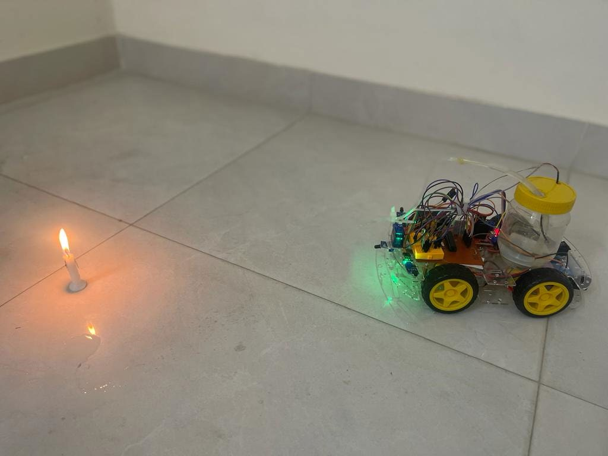
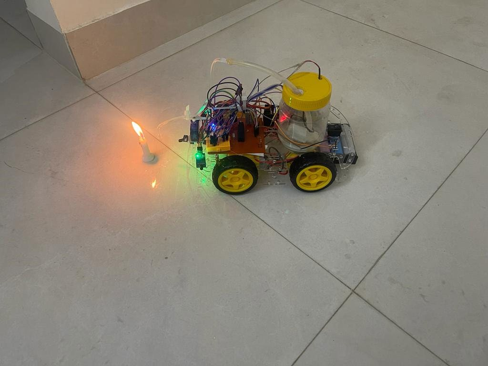
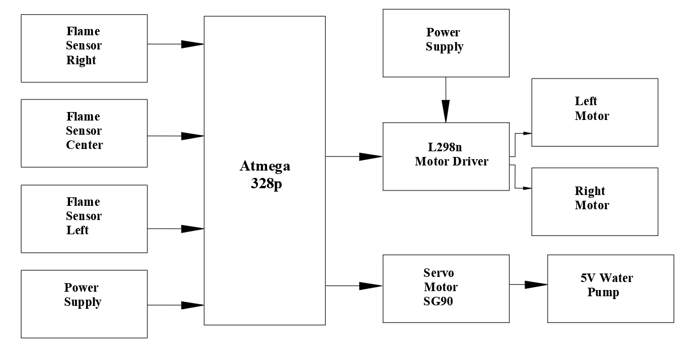
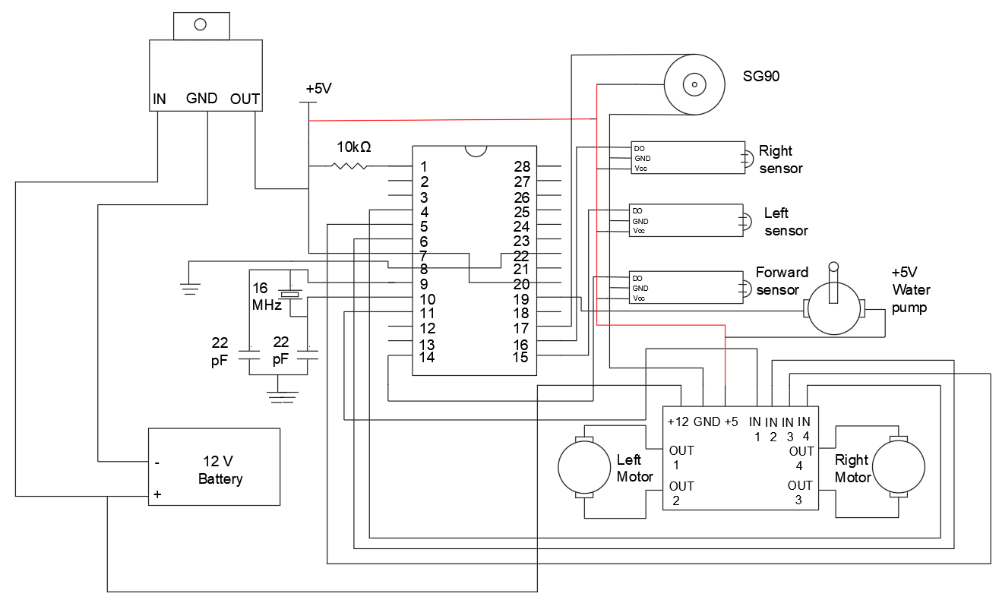
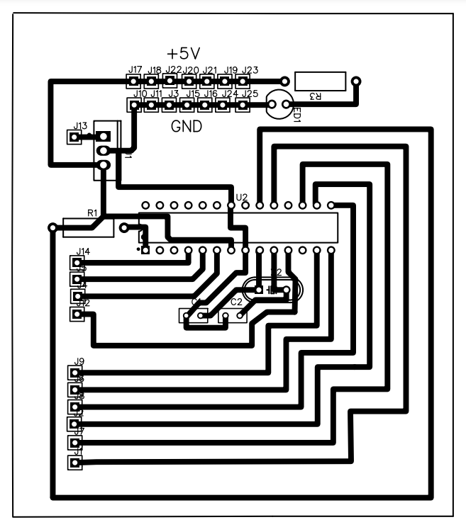
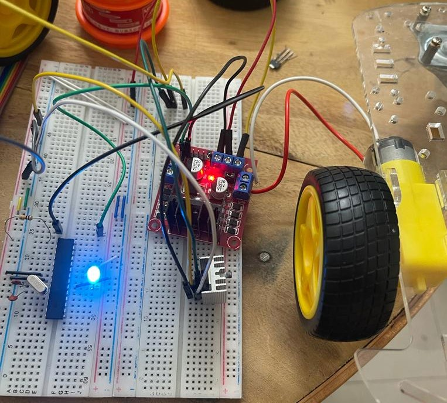
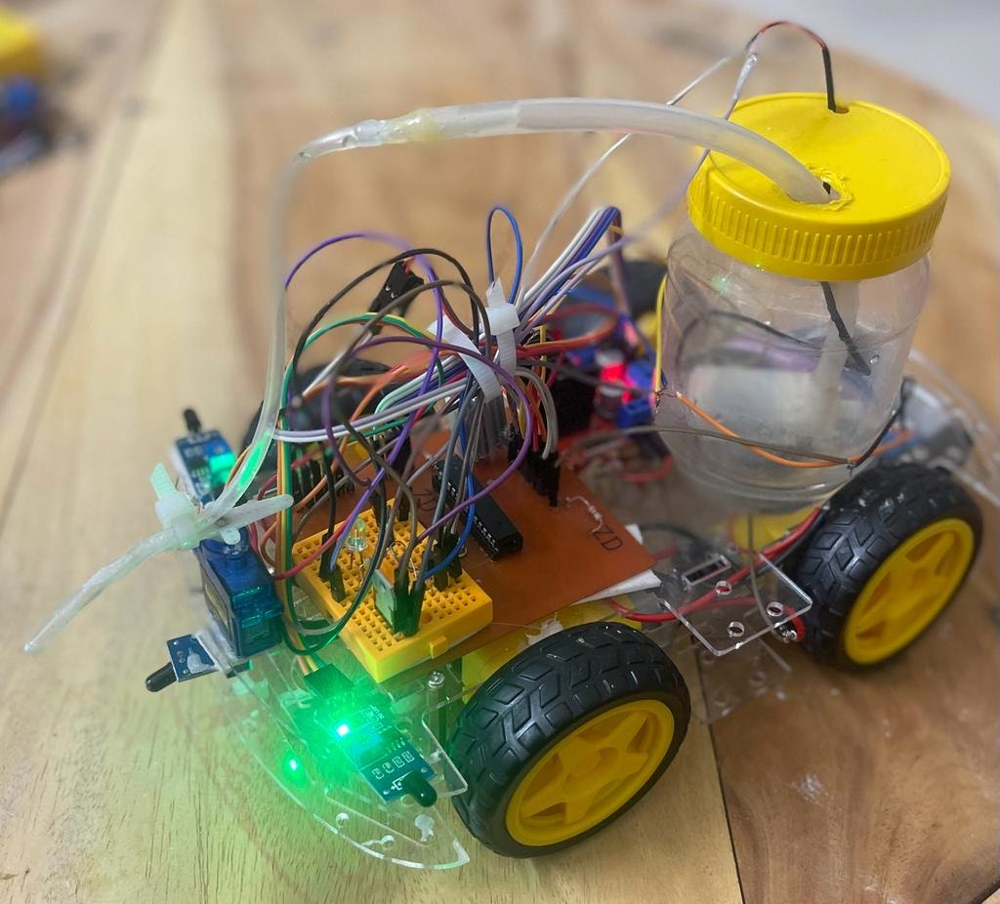
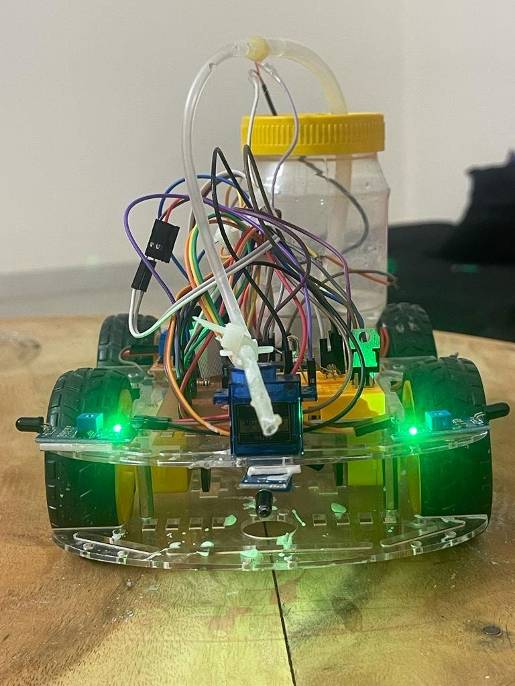

# Firefighting Robotic Vehicle

A low-cost 4WD robot that finds a flame with three flame sensors, drives toward it, and puts it out with a servo-swept water spray. It is built around a standalone ATmega328P on a custom PCB.

<p align="center">
  
  
</p>

## How it works

1. Three flame sensors (left, center, right) sit at the front of the chassis. Each gives a digital output that goes LOW when it sees a flame.
2. If none of them sees a flame, the robot stays still.
3. If a side sensor sees a flame, the robot turns toward it in 500 ms steps until the center sensor sees it.
4. Once the center sensor sees the flame, the robot drives forward for about 0.3 s, stops, and starts the 5V water pump.
5. While the pump runs, an SG90 servo sweeps the nozzle from 50° to 130° and back, then the pump stops and the nozzle returns to 90°.
6. The loop repeats until no sensor sees a flame.

The robot was tested indoors against a candle flame and detected it under both normal and dark lighting. The design targets flames within a 22-inch (56 cm) radius of the sensors.

<p align="center">
  
</p>

## Hardware

| Component | Qty | Role |
|---|---|---|
| ATmega328P (Arduino bootloader) | 1 | Main controller |
| 16 MHz crystal + 2 × 22 pF capacitors | 1 set | Clock |
| 10 kΩ resistor | 1 | Reset pull-up |
| Flame sensor module (digital out) | 3 | Left, center, right flame detection |
| L298N dual H-bridge motor driver | 1 | Drives the gear motors |
| Robot chassis with gear motors and wheels | 4 + 4 | 4WD drive |
| SG90 micro servo | 1 | Sweeps the water nozzle |
| 5V mini submersible pump + small container + pipe | 1 | Water spray |
| 7805 voltage regulator | 1 | 5V logic supply |
| 12V battery | 1 | Main power |
| Custom PCB / breadboard, connecting wires | — | Assembly |

## Pin map

| Function | Arduino pin | ATmega328P pin |
|---|---|---|
| Left motor IN (LM1, LM2) | D2, D3 | 4, 5 |
| Right motor IN (RM1, RM2) | D4, D5 | 6, 11 |
| Forward flame sensor | D8 | 14 |
| Left flame sensor | D9 | 15 |
| Right flame sensor | D10 | 16 |
| SG90 servo signal | D11 | 17 |
| Water pump | D13 | 19 |

Power: the 12V battery feeds the L298N motor supply and the 7805, which provides 5V for the microcontroller, sensors and servo.

## Circuit and PCB

<p align="center">
  
</p>

<p align="center">
  
  
</p>

<p align="center">
  
  
</p>

## Firmware

The sketch is in [`firmware/firefighting_robot/firefighting_robot.ino`](firmware/firefighting_robot/firefighting_robot.ino) and uses only the built-in `Servo` library.

To upload it:

1. Open the sketch in the Arduino IDE.
2. Select **Arduino Uno** as the board, since it matches an ATmega328P with a 16 MHz crystal.
3. Upload through a USB-to-serial adapter, or program the chip in an Uno board and move it to the robot.

### Changes from the original version

The first version of the code had two bugs, which are fixed in this repo. **These fixes have not been tested on the robot.**

- **Right turn:** the original set all four motor pins HIGH, which brakes the motors instead of turning. It now mirrors the left-turn branch.
- **Return sweep:** the original second servo loop started at 50° with the condition `pos >= 130`, so it never ran. It now sweeps back from 130° to 50°.

## Repository structure

```
.
├── README.md
├── firmware/
│   └── firefighting_robot/
│       └── firefighting_robot.ino
└── images/        # block diagram, circuit, PCB layout, build and test photos
```

## Author

**Saeedul Haque**
